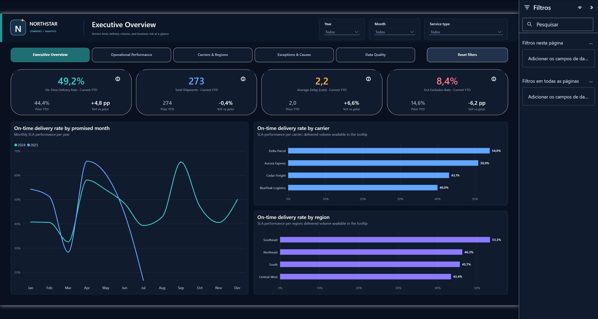
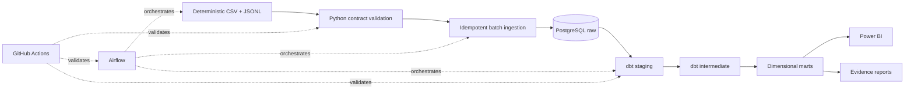

# Operations Analytics Platform

> A reproducible logistics analytics platform that turns governed shipment data into operational decisions.

[](pyproject.toml)
[](https://github.com/ericcurtygiorno/operations-analytics-platform/actions/workflows/ci.yml)
[](dbt_project.yml)
[](docker-compose.yml)
[](orchestration/dags/operations_analytics_pipeline.py)
[](dashboard/operations-analytics-platform.pbip)



## At a glance

Northstar Commerce is a fictional e-commerce company that needs a reliable view of delivery SLAs,
carrier performance, regional bottlenecks, freight exposure, exceptions, and data quality. This
project implements the complete analytical path from deterministic synthetic sources to a governed
five-page Power BI control tower.

| Verified proof | Result |
|---|---:|
| Synthetic shipments | 756 |
| dbt models | 11 |
| dbt tests | 40 passing |
| Python tests | 10 passing |
| Power BI pages | 5 |
| Explicit DAX measures | 100 |

[Open the Power BI project](dashboard/operations-analytics-platform.pbip) ·
[Browse dashboard screenshots](dashboard/screenshots) ·
[Read the technical documentation](docs/architecture.md) ·
[Review the evidence](artifacts/evidence/stage-1-3-evidence.json)

The 60–90 second walkthrough will be recorded with the other portfolio videos during the final
showcase phase.

## Business problem

Operations teams need to distinguish a real service problem from a data-quality problem. The
platform answers:

- How often are SLA-eligible shipments delivered on time?
- Which carriers, regions, distribution centers, and service types underperform?
- Where do order-to-ship and ship-to-delivery bottlenecks occur?
- Which exception causes create the largest operational exposure?
- Which invalid records must be excluded from governed KPI denominators?

## Architecture



Airflow runs the real generator, ingestion, dbt build, and evidence publication commands. Docker
Compose provides PostgreSQL and isolated pipeline runtimes, while GitHub Actions repeats the
Python, dbt, integration, evidence, Compose, and DAG-contract checks.

## Capabilities demonstrated

- deterministic synthetic generation with seed, manifest, checksums, and intentional anomalies;
- immutable, idempotent raw ingestion with batch lineage and cross-platform hash stability;
- dbt staging, intermediate, and dimensional marts at shipment grain;
- generic and custom tests that keep invalid rows out of the SLA denominator;
- operational analysis backed by machine-readable evidence;
- a real scheduled Airflow DAG with parameters, retries, timeout, logging, and failure propagation;
- a source-controlled PBIP semantic model with explicit DAX and recruiter-ready report pages;
- containerized local execution and executable CI checks.

## Selected findings

These findings come from the deterministic sample and can be reproduced from
[`analysis/operational_analysis.sql`](analysis/operational_analysis.sql):

- Overall on-time delivery is **47.38%** across 667 SLA-eligible shipments.
- Delta Parcel leads the named carriers at **54.01%** on time; BluePeak Logistics trails at
  **40.00%**.
- Southeast leads regional on-time delivery at **53.33%**, while Central-West is lowest at
  **43.42%**.
- Capacity is the largest recorded exception category: **101 shipments**, or **27.52%** of
  exception-bearing shipments.
- **89 shipments (11.77%)** are excluded from the SLA denominator by explicit quality rules.

These are simulated operational patterns, not causal claims or estimates of real business impact.

## Analytical model and KPI governance

The mart is a star schema centered on `marts.fact_deliveries`, with date, customer, carrier,
distribution-center, location, and service-type dimensions. The active reporting calendar is the
promised delivery date; other date roles are activated explicitly by DAX measures.

On-time delivery uses only records that satisfy the governed SLA eligibility rules. Current YTD
and prior YTD align the same selected months, so the partial 2025 period is not compared against a
complete 2024 year.

- [Data model and grain](docs/data-model.md)
- [Metric dictionary](docs/metrics.md)
- [Business rules](docs/business-rules.md)
- [Data dictionary](docs/data-dictionary.md)
- [Data contracts](docs/data-contracts.md)

## Dashboard

The PBIP report contains five pages:

1. **Executive Overview** — YTD/YoY KPIs and service-level trends.
2. **Operational Performance** — throughput, cycle time, distribution centers, and service types.
3. **Carriers & Regions** — partner scorecard, delivered volume, freight, and regional exposure.
4. **Exceptions & Causes** — exception trends, root causes, and shipment detail.
5. **Data Quality** — governed exclusions and record-level quality flags.

Executive Overview is the landing page. Detail pages are hidden from report tabs and reached through
the in-report navigation. KPI cards include plain-language calculation tooltips.

[Dashboard guide](dashboard/README.md) · [Static screenshot gallery](dashboard/screenshots)

## Run locally

Prerequisite: Docker Desktop with the Docker engine running.

```powershell
Copy-Item .env.example .env
```

Choose a local password in `.env`, then run the complete pipeline:

```powershell
.\scripts\run_containerized_pipeline.ps1
```

This regenerates the sources, loads PostgreSQL, builds and tests dbt, and publishes the evidence
artifact. Open [`dashboard/operations-analytics-platform.pbip`](dashboard/operations-analytics-platform.pbip)
in Power BI Desktop to refresh the report against `localhost:55432`.

To validate the real Airflow DAG end to end:

```powershell
.\scripts\run_airflow_validation.ps1
```

To stop services without deleting volumes:

```powershell
.\scripts\stop_airflow.ps1
.\scripts\stop_local_database.ps1
```

Detailed instructions are in [setup](docs/setup.md), [orchestration](docs/orchestration.md), and
[troubleshooting](docs/troubleshooting.md).

## Test and evidence strategy

```powershell
python -m unittest discover -s tests -v
docker compose config --quiet
```

`dbt build` is executed by both pipeline scripts. The latest verified result is 51 successful dbt
nodes: 11 models and 40 tests. The evidence publisher combines database assertions and dbt run
results into [`artifacts/evidence/stage-1-3-evidence.json`](artifacts/evidence/stage-1-3-evidence.json).

- [Test catalog](docs/test-catalog.md)
- [Quality report](docs/quality-report.md)
- [Validation record](docs/validation.md)
- [Operational analysis](docs/analysis.md)

## Repository map

```text
analysis/          reproducible analytical queries
artifacts/         versioned machine-readable evidence
dashboard/         PBIP report, semantic model, and screenshots
dbt/               staging, intermediate, marts, macros, and tests
docs/              architecture, governance, decisions, and runbooks
orchestration/     Airflow DAG
sample_data/       small deterministic source bundle
scripts/           bootstrap, validation, reset, and stop commands
src/               generator, ingestion, and evidence publisher
tests/             Python unit and integration-oriented tests
```

## Engineering decisions and boundaries

The design deliberately favors auditability over decorative complexity: raw batches are immutable,
invalid records remain visible but are excluded from governed metrics, the mart stays at shipment
grain, and Airflow uses a lightweight local runtime rather than pretending to be a production
cluster.

- [Architecture](docs/architecture.md)
- [Decision records](docs/decisions/README.md)
- [Limitations and next steps](docs/limitations.md)
- [Project completion audit](docs/project-audit.md)

## Author

**Eric Curty Giorno** — Data Analytics, Business Intelligence, Analytics Engineering, and Data Engineering

[LinkedIn](https://linkedin.com/in/eric-curty-giorno) ·
[GitHub](https://github.com/ericcurtygiorno) ·
[Email](mailto:ericcurty@hotmail.com)

This portfolio project uses only synthetic data. AI assisted with implementation and review;
architecture, business rules, KPI definitions, validation, and final decisions remain author-owned.

## License

[MIT](LICENSE)
