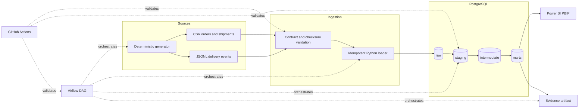

# Architecture

## System flow



## Implemented boundary

The verified implementation covers deterministic source generation, schema and checksum validation,
idempotent immutable-batch ingestion, PostgreSQL lineage metadata, dbt staging/intermediate/marts,
automated data tests, evidence publication, a five-page Power BI report, Docker Compose execution, a
real Airflow DAG, and executable GitHub Actions checks.

The local runtime is intentionally compact. PostgreSQL is the analytical store, short-lived
containers run the pipeline and dbt dependencies, and Airflow uses `standalone` with
`LocalExecutor`. This demonstrates orchestration behavior without claiming production-scale
infrastructure.

## Layer responsibilities

| Layer | Responsibility | Important guarantee |
|---|---|---|
| Source generator | Create orders, shipments, and delivery events | Same seed and config produce the same logical bundle |
| Python ingestion | Validate contracts and load a source batch | Retrying the same batch does not duplicate rows |
| `raw` | Preserve source values and lineage | Rows retain batch, file, hash, and row-number context |
| `staging` | Type, normalize, deduplicate, and flag | Only the latest completed batch is selected |
| `intermediate` | Join lifecycle data and apply reusable rules | One enriched row per shipment |
| `marts` | Publish governed dimensions and fact | One fact row per shipment |
| Evidence | Materialize quality and analytical results | Claims are machine-readable and reproducible |
| Power BI | Serve operational decisions | Explicit measures and governed denominators |

## Deployment views

### Standard local pipeline

```text
Docker Desktop
├── PostgreSQL :55432
└── Short-lived pipeline container
    ├── source generation
    ├── Python ingestion
    ├── dbt build
    └── evidence publication

Power BI Desktop ──Import──> PostgreSQL marts
```

### Orchestrated local pipeline

```text
Airflow standalone :8080
└── operations_analytics_pipeline
    ├── generate_source_bundle
    ├── ingest_raw_batch
    ├── build_and_test_dbt
    └── publish_analysis_evidence

PostgreSQL remains a separate analytics service.
```

## Reliability and security boundaries

- Source paths passed to the DAG must remain inside the project checkout.
- Commands are executed as argument lists rather than interpolated shell strings.
- Secrets live in `.env`, which is ignored by Git; `.env.example` contains only placeholders.
- Raw records are append-only within an immutable batch; downstream models use completed batches.
- Invalid records are observable in the fact but cannot enter the governed SLA denominator.
- The dataset is entirely synthetic and contains no real customer PII.

## Related references

- [Analytical data model](data-model.md)
- [Airflow orchestration](orchestration.md)
- [Decision records](decisions/README.md)
- [Setup](setup.md)
- [Limitations](limitations.md)
