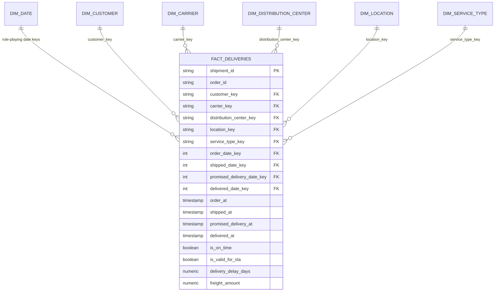

# Analytical Data Model

The governed analytical layer is a shipment-grain star schema designed for operational service,
cost, cycle-time, exception, and data-quality analysis.

## Grain and responsibility

| Model | Grain | Responsibility |
|---|---|---|
| `raw.orders` | One received CSV row | Immutable source copy and ingestion lineage |
| `raw.shipments` | One received CSV row | Immutable source copy and ingestion lineage |
| `raw.delivery_events` | One received JSON event | Original payload plus extracted source fields |
| `stg_orders` | One deduplicated order identifier per latest completed batch | Typing, normalization, deduplication, and order-quality flags |
| `stg_shipments` | One shipment per latest completed batch | Typing, normalized statuses, and shipment-quality flags |
| `stg_delivery_events` | One delivery event per latest completed batch | Typed lifecycle and exception events with original JSON retained |
| `int_deliveries_enriched` | One shipment | Order enrichment, event aggregation, cycle times, SLA logic, and quality rules |
| `fact_deliveries` | One shipment | Governed analytical fact consumed by Power BI |
| Each `dim_*` table | One distinct business member | Descriptive filtering and stable star-schema relationships |

## Fact design

`fact_deliveries` is intentionally inclusive. Valid records and detected anomalies remain visible,
while explicit flags control metric eligibility. This supports two separate questions:

1. What happened operationally?
2. Which rows are trustworthy for a governed KPI denominator?

The fact contains additive measures such as quantity, weight, freight, attempts, and exception
counts; semi-additive duration measures; lifecycle timestamps; and data-quality flags. Natural
shipment and order identifiers are retained for drill-through and traceability.

## Dimension and key strategy

- Dimension keys are deterministic MD5 hashes of normalized natural values.
- The carrier dimension includes a governed unknown member because unknown carriers are an
  intentional source anomaly that must remain measurable.
- Missing order-derived dimension keys remain null in the fact. This preserves orphan evidence
  instead of silently assigning a valid business member.
- `dim_customer` contains only synthetic identifiers and no real PII.
- Dimensions are Type 1 because the current deterministic source does not contain attribute
  history. Introducing SCD behavior without a changing source would be decorative complexity.

## Role-playing dates

`dim_date` relates to four fact dates:

| Date role | Purpose | Power BI relationship |
|---|---|---|
| Promised delivery date | SLA trends and the primary operational reporting calendar | Active |
| Order date | Demand and order-to-ship analysis | Inactive; activated by measure when required |
| Shipped date | Dispatch and transit analysis | Inactive; activated by measure when required |
| Delivered date | Completed-delivery analysis | Inactive; activated by measure when required |

Promised delivery date is active because the dashboard primarily evaluates service against the
customer promise. Explicit measures prevent ambiguous date filtering.

## Why there is no separate order fact yet

The current scenario emits one regular shipment per order and does not contain item-level facts.
A second order fact would duplicate nearly all analytical content without enabling a new honest
business question. Order attributes are therefore carried into the shipment fact. A dedicated
`fact_orders` becomes justified when the source supports split shipments, order lines, partial
fulfilment, cancellations, or order-level revenue.

## Why events are aggregated before the mart

Raw and staging preserve delivery events at event grain. The current dashboard needs exception
count, first exception time, and failure reason per shipment, so events are aggregated in
`int_deliveries_enriched` before joining the fact. A separate `fact_delivery_events` should be
introduced only when event-sequence, dwell-time, or scan-level analysis becomes a requirement.

## Deduplication and late data

- Raw uniqueness is enforced by `(source_file_hash, source_row_number)`.
- Staging selects the latest completed immutable load, preventing multiple deterministic batches
  from duplicating business keys.
- Duplicate non-empty order identifiers retain the earliest raw row within the source batch and
  expose `duplicate_rank` upstream for traceability.
- The current batch model is replacement-oriented. Incremental late-arriving merge behavior is a
  documented future extension rather than an unimplemented claim.

## Model integrity

dbt tests verify fact uniqueness, required keys, accepted statuses, and relationships to every
dimension. Custom tests also ensure that invalid records and impossible timelines never enter the
SLA denominator. Executable results are published in [quality-report.md](quality-report.md).
